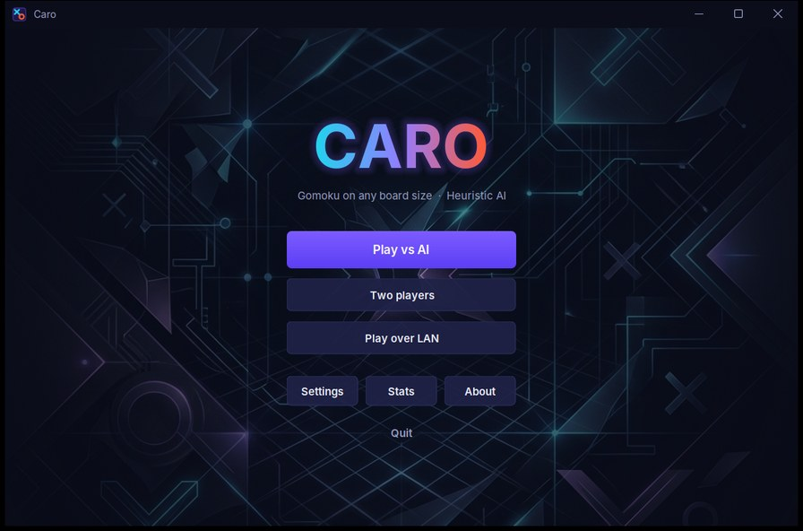
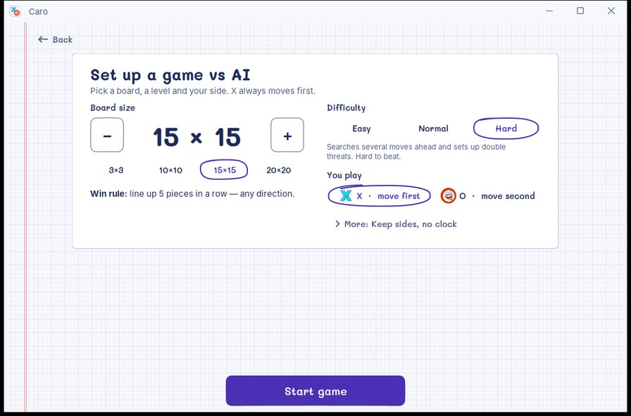
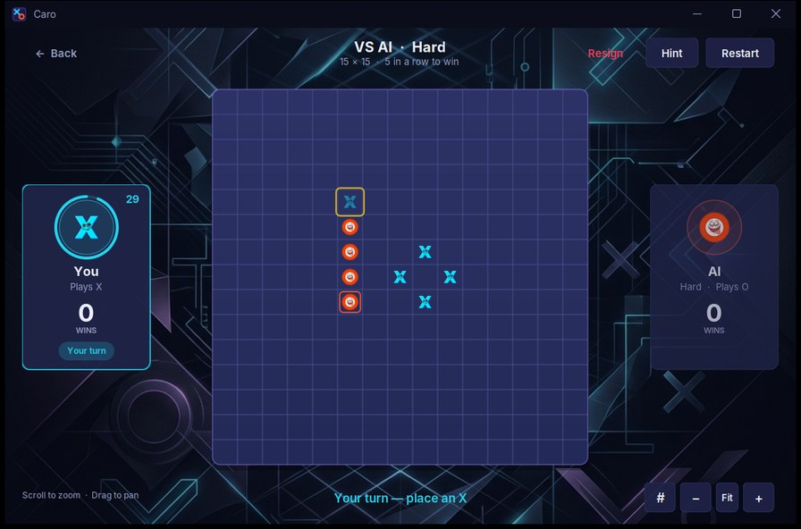
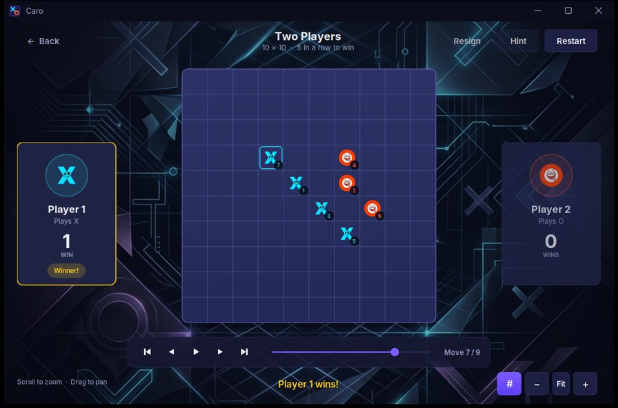
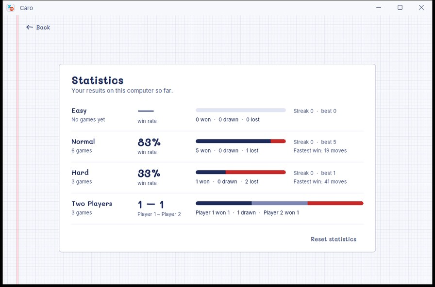
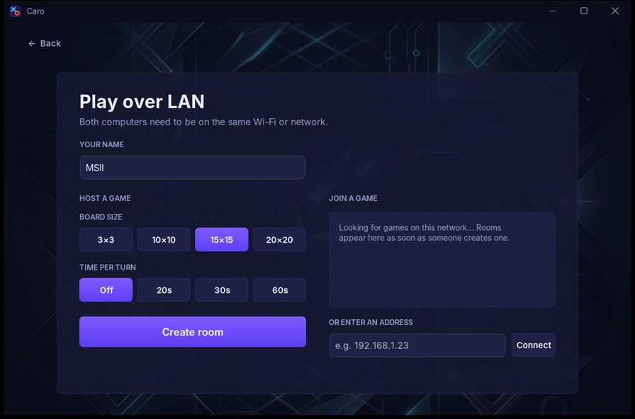

<div align="center">
  <a href="#english">🇬🇧 English</a> &nbsp; | &nbsp; <a href="#tiếng-việt">🇻🇳 Tiếng Việt</a>
</div>

---

<h1 id="english">Caro NxN: Gomoku on notebook paper</h1>


A modern, highly optimized, and scalable implementation of the classic Gomoku (Caro/Tic-Tac-Toe) game built with Java Swing and [FlatLaf](https://www.formdev.com/flatlaf/). The interface looks like a page from a Vietnamese school notebook, with ballpoint lines and two ridiculous faces as the pieces. The game has dynamic NxN board generation, an AI opponent with three levels (from a custom **Heuristic Pattern Matching** engine up to a time-limited alpha-beta search), English and Vietnamese, and play over LAN between two computers.

## Screenshots

| | |
|:-:|:-:|
|  |  |
| Main menu | Setup: board, AI level, side, turn time |
|  |  |
| Playing the hard AI, with a hint and the turn clock | Replay with move numbers |
|  |  |
| Lifetime statistics | LAN lobby: host or join a room |

## Table of Contents
- [Screenshots](#screenshots)
- [Features](#features)
- [In-Depth AI Algorithm](#in-depth-ai-algorithm)
- [Architecture & Design](#architecture--design)
- [Download](#download)
- [Prerequisites & Installation](#prerequisites--installation)
- [Usage & Configuration](#usage--configuration)

## Features

### Gameplay
- **Dynamic Board Sizing:** Any NxN board from 3x3 to 20x20, with quick presets and the last size remembered.
- **Clear win rule:** 3x3 to 5x5 need a full row, column or diagonal; 6x6 and up need 5 in a row. The rule is shown before and during the game.
- **Zoom & Pan:** Mouse-wheel zoom anchored at the cursor, drag to pan, plus zoom/fit buttons; the board auto-fits the window.
- **Three ways to play:** VS AI, two players on one computer, or two computers on the same Wi-Fi (LAN).
- **AI levels:** Easy (misses threats on purpose), Normal (the original heuristic) and Hard (alpha-beta search that sets up double threats).
- **Choose your side:** play X (move first) or O against the AI, and optionally alternate who starts every round.
- **Turn clock & resign:** optional 10–60 s per turn (running out loses the round) and a Resign button.
- **Hints:** ask the Hard engine for the best move (`H`); can be turned off in Settings.
- **Replay:** after a round, step through it move by move or let it play back; optional move numbers on the pieces.
- **Statistics:** win rate, streaks and fastest win per AI level, plus the two-player head-to-head, kept between launches.
- **Undo (optional):** Enable "Allow undo" in Settings; against the AI it takes back your move and the AI's reply.

### User Interface (UI/UX)
- **Notebook paper look:** a bright squared page with a pink margin line, the Mali handwriting font for titles and buttons, and Inter for small text. Active text meets 4.5:1 contrast and controls 3:1.
- **Circle your answer:** the chosen option is circled in pen, as on a paper quiz, so the only solid button on a screen is the main action.
- **Quick start:** "Play now" on the main menu starts a game with your last settings and says which ones.
- **Pen-drawn board:** hover preview of your next piece, pop-in animation and a pen circle around the last move. The winning line gets a yellow highlighter and a red pen loop drawn around it, under the pieces, so no face is crossed out.
- **Nothing covers the board:** the result, "Play again" and the replay controls sit in a fixed row below it, and the board never changes size.
- **Player panels:** large faces, a pen circle that runs out with the turn clock, and wins kept as tally marks.
- **Keyboard play:** arrow keys move a cursor on the board and `Enter` or `Space` places a piece; every control can be reached with `Tab`.
- **Keyboard shortcuts:** `Ctrl+Z` undo, `H` hint, `R` restart, `N` move numbers, `F` fit board, `+`/`-` zoom, `←`/`→`/`Space` replay, `Esc` back.
- **Audio settings:** Background music and sound effects can be switched off; clips load on a background thread.
- **English & Tiếng Việt:** switch language in Settings; every screen reloads instantly.

## In-Depth AI Algorithm

The **Normal** level relies on a **Heuristic Pattern Matching** algorithm, described in sections 1–6. A full Minimax search scales poorly on large NxN boards because its cost grows exponentially, $\mathcal{O}(b^d)$; this heuristic evaluates the board locally and responds in sub-milliseconds, regardless of the board size. The **Hard** level (section 7) does use alpha-beta search, but keeps it affordable with a time budget, a small set of candidate cells and forced-move pruning.

### 1. 4-Directional Ray Casting
For every empty cell `(x, y)` on the board, the AI casts rays in 4 axes:
- Horizontal `(0, 1)`
- Vertical `(1, 0)`
- Primary Diagonal `(1, 1)`
- Secondary Diagonal `(1, -1)`

It counts contiguous pieces belonging to a specific player and identifies how many ends are blocked (by the board edge or the opponent's pieces).

### 2. Dual Evaluation Mechanism
Every empty cell receives two distinct evaluations:
- **Attack Score:** "If I (AI) place my piece here, how close does it get me to winning?"
- **Defense Score:** "If the Human places their piece here, how dangerous is it?"

The final value for an empty cell is: `TotalScore(x, y) = AttackScore + DefenseScore`. 

### 3. Base Scoring Mathematical Function
The algorithm applies an exponential weight based on the contiguous piece count:
```java
long base = (long) Math.pow(10, count + 1);
```
- 1 piece in a row $\rightarrow$ 100 points
- 2 pieces in a row $\rightarrow$ 1,000 points
- 3 pieces in a row $\rightarrow$ 10,000 points
- 4 pieces in a row $\rightarrow$ 100,000 points

### 4. Strategic Multipliers & Blocking Mechanics
- **Aggressive Multiplier:** Attack scores are multiplied by `1.2x` to slightly favor proactive expansion over purely passive defending.
- **Half-blocked Penalty:** If a pattern is blocked on one end (`blocks == 1`), the base score is strictly halved (`base / 2`).
- **Dead-end Nullification:** If a pattern is blocked on both ends (`blocks == 2`) and hasn't reached the winning length, the score is forced to `0` because it's a dead pattern.

### 5. Winning Priorities (Lethal Threat Handling)
When a pattern reaches the target winning length (e.g., 5 in a row), exponential scaling is overridden by absolute priority constants:
- **AI Win (Attack):** `1,000,000,000` (First priority: If the AI can win immediately, it takes the move).
- **Human Win (Defense):** `500,000,000` (Second priority: If the AI cannot win immediately but the human is about to win, it MUST block).

### 6. Complexity Analysis
By scanning only from empty cells and limiting the ray cast distance to the target winning length (max 5 steps per direction), the time complexity per AI turn is strictly $\mathcal{O}(N^2)$, where $N$ is the board dimension. This keeps the Normal level at about `1ms` per move even on the largest 20×20 board. To prevent the AI from feeling overly robotic, a randomized artificial delay (300ms - 800ms) is injected to simulate "thinking" time.

### 7. Difficulty Levels
- **Easy** (`EasyAi`): always takes a win, but blocks your winning move only 60% of the time and picks among its top six cells 35% of the time.
- **Normal** (`HeuristicAi`): the single-ply heuristic described above.
- **Hard** (`SearchAi`): negamax with alpha-beta and iterative deepening for ~250 ms, scored by `PatternEvaluator`, which counts every 5-cell window holding only one player's stones (so gapped shapes like `XX_X` count). A side that can complete a line wins at once and a side facing a winning threat may only block it, which lets it see about six moves ahead. In local tests it never lost to Normal.

The AI runs on a background thread, so the window never freezes while it thinks.

## Architecture & Design

The project strictly adheres to the **Model-View-Controller (MVC)** pattern:
- **Model (`src/model`):** `GameModel` (board, turns, win/draw/forfeit, move history for undo and replay), `model/ai` (Easy, Normal and Hard engines), `Settings` and `Stats` (persisted with `java.util.prefs`).
- **Controller (`src/controller`):** the `GameSession` interface, implemented by `GameController` (local games: AI thread, undo, turn clock) and `NetworkGameController` (LAN games); `LanMatchmaker` sets up LAN connections.
- **Network (`src/net`):** the line-based `Protocol`, `Connection` (reader thread, send queue, heartbeat), `LanHost`/`LanClient` and UDP `LanDiscovery`.
- **View (`src/view`):** `MainWindow` hosts the screens in a `CardLayout`; reusable components live in `view/components` and the design tokens in `view/theme/Theme`.
- **Tests (`test`):** JUnit 5 tests for the rules, every AI level, the controllers, statistics, translations and the network code (over loopback).

## Download

Get the latest version from the [Releases page](https://github.com/Thien21112005/heuristic-caro-nxn/releases/latest):

- **Windows (no Java needed):** download `Caro-windows.zip`, extract it anywhere and run `Caro\Caro.exe`. It carries its own Java runtime. Windows SmartScreen may warn that the app is from an unknown publisher because it is not code-signed: click **More info → Run anyway**.
- **Any OS with Java 17+:** download `caro-nxn.jar` and run `java -jar caro-nxn.jar` (or double-click it if `.jar` files open with Java).

To build the Windows app yourself, run `mvn -Ppackage-win package` (JDK 17+ with `jpackage`); the result is in `target/dist/Caro`.

## Prerequisites & Installation

### Requirements
- **Java Development Kit (JDK):** Version 17 or higher.
- **Apache Maven:** 3.8 or higher (downloads FlatLaf automatically).
- **IDE (Optional but recommended):** IntelliJ IDEA, Eclipse, or Visual Studio Code with the Java Extension Pack.

### Installation & Compilation (Command Line)
1. **Clone the repository:**
   ```bash
   git clone https://github.com/Thien21112005/heuristic-caro-nxn.git
   ```
2. **Navigate to the project directory:**
   ```bash
   cd heuristic-caro-nxn
   ```
3. **Run the game directly:**
   ```bash
   mvn compile exec:java
   ```
4. **Or build a standalone jar and run it:**
   ```bash
   mvn package
   java -jar target/caro-nxn.jar
   ```
5. **Run the tests:**
   ```bash
   mvn test
   ```

### Running with IntelliJ IDEA
1. Open IntelliJ IDEA and select **Open**.
2. Choose the `pom.xml` in the cloned `heuristic-caro-nxn` folder and open it **as a Project**.
3. Wait for Maven to download the dependencies.
4. Open `src/main/RunGame.java` and click the green **Run** button next to `main`.

## Usage & Configuration
**Settings** (saved automatically between launches):
- **Background music** / **Sound effects:** turn audio on or off.
- **Allow undo:** off by default (no take-backs). When on, an Undo button (`Ctrl+Z`) appears in the game. Against the AI it reverts both your move and the AI's reply.
- **Allow hints:** on by default; shows the Hint button.
- **Language:** English or Tiếng Việt.

**Controls:** mouse wheel to zoom, drag to pan, `F` to fit the board, `R` to restart, `Esc` to go back.

### Playing over LAN
Both computers must be on the same Wi-Fi or wired network.

1. **Host:** Main menu → **Play over LAN** → enter your name, pick the board size and turn time → **Create room**. The screen shows the address others can use, e.g. `192.168.1.23 · port 45678`.
2. **Join:** on the other computer open **Play over LAN**. The room appears in the list after a second or two; click it. If it does not show up, type the host's address (`192.168.1.23`, or `192.168.1.23:45678` if the port differs) and press **Connect**.
3. The host plays X in the first round; pieces swap every round. **Play again** asks the opponent first. Undo and hints are disabled in LAN games, and a dropped connection ends the round without counting it.

**Firewall:** the first time you create a room, Windows may ask whether Java may use the network. Choose **Allow** (private networks are enough), or nobody can join. The game uses TCP port **45678** for the match (another free port if that one is busy) and UDP port **45679** to announce rooms.

**If joining fails:** check both machines are on the same network, try typing the address by hand, and note that some public or school Wi-Fi networks block devices from talking to each other (client isolation). In that case, turn on a phone hotspot or one laptop's hotspot and connect both computers to it.

---

<br><br>

<h1 id="tiếng-việt">Caro NxN: cờ caro trên giấy ô ly</h1>

Một phiên bản mở rộng, hiện đại và tối ưu hóa cao của trò chơi cờ Caro (Gomoku) kinh điển, được xây dựng bằng Java Swing và [FlatLaf](https://www.formdev.com/flatlaf/). Giao diện giống một trang vở ô ly, với nét bút bi và hai quân mặt hề làm nhân vật chính. Trò chơi hỗ trợ linh hoạt kích thước bàn cờ NxN, AI với ba mức độ khó (từ thuật toán **Heuristic Pattern Matching** tự xây dựng tới tìm kiếm alpha-beta có giới hạn thời gian), song ngữ Anh – Việt, và chơi qua mạng LAN giữa hai máy.

## Ảnh chụp màn hình

| | |
|:-:|:-:|
|  |  |
| Menu chính | Thiết lập: bàn cờ, độ khó, phe, thời gian |
|  |  |
| Đấu AI mức Khó, có gợi ý và đồng hồ | Xem lại ván kèm số thứ tự nước đi |
|  |  |
| Thống kê lâu dài | Sảnh LAN: tạo hoặc vào phòng |

## Mục lục
- [Ảnh chụp màn hình](#ảnh-chụp-màn-hình)
- [Tính năng nổi bật](#tính-năng-nổi-bật)
- [Phân tích sâu Thuật toán AI](#phân-tích-sâu-thuật-toán-ai)
- [Kiến trúc & Thiết kế](#kiến-trúc--thiết-kế)
- [Tải game](#tải-game)
- [Hướng dẫn cài đặt](#hướng-dẫn-cài-đặt)
- [Sử dụng & Cấu hình](#sử-dụng--cấu-hình)

## Tính năng nổi bật

### Gameplay
- **Kích thước bàn linh hoạt:** Mọi bàn NxN từ 3x3 đến 20x20, có nút chọn nhanh và nhớ kích thước lần trước.
- **Luật thắng rõ ràng:** Bàn 3x3 đến 5x5 phải đủ cả hàng/cột/đường chéo; từ 6x6 trở lên cần 5 quân liên tiếp. Luật được hiển thị trước và trong ván.
- **Zoom & kéo bàn cờ:** Lăn chuột để zoom quanh con trỏ, kéo để di chuyển, có nút zoom/vừa khung; bàn cờ tự co giãn theo cửa sổ.
- **Ba cách chơi:** Đấu với máy, hai người trên cùng một máy, hoặc hai máy chung Wi-Fi (LAN).
- **Độ khó AI:** Dễ (cố tình bỏ sót đòn), Thường (thuật toán heuristic gốc) và Khó (tìm kiếm alpha-beta, biết tạo nước đôi).
- **Chọn phe:** cầm X (đi trước) hoặc O khi đấu với máy, và có thể đổi người đi trước sau mỗi ván.
- **Đồng hồ & đầu hàng:** tuỳ chọn 10–60 giây mỗi lượt (hết giờ là thua ván) và nút Đầu hàng.
- **Gợi ý:** hỏi AI mức Khó nước đi mạnh nhất (`H`); có thể tắt trong Cài đặt.
- **Xem lại ván:** sau mỗi ván có thể xem từng nước hoặc cho tự phát; có thể hiện số thứ tự nước đi trên quân.
- **Thống kê:** tỉ lệ thắng, chuỗi thắng và ván thắng nhanh nhất cho từng độ khó, cộng tỉ số đối đầu hai người, lưu lại giữa các lần mở game.
- **Lùi nước (tuỳ chọn):** Bật "Cho phép lùi nước" trong Cài đặt; khi đấu với AI sẽ lùi cả nước của bạn lẫn nước của AI.

### Giao diện & Trải nghiệm (UI/UX)
- **Giao diện giấy ô ly:** nền ô ly sáng với đường kẻ lề hồng, font viết tay Mali cho tiêu đề và nút, font Inter cho chữ nhỏ. Chữ đang dùng đạt độ tương phản 4.5:1, các nút điều khiển đạt 3:1.
- **Khoanh tròn đáp án:** lựa chọn đang chọn được khoanh bằng bút như khi làm bài trên giấy, nên mỗi màn chỉ có đúng một nút tô đặc là hành động chính.
- **Vào ván nhanh:** nút "Chơi ngay" ở menu bắt đầu ván theo cài đặt lần trước và ghi rõ cài đặt đó.
- **Bàn cờ nét bút:** xem trước quân khi rê chuột, hiệu ứng đặt quân và vòng bút quanh nước vừa đi. Đường thắng được tô dạ quang vàng và khoanh bút đỏ bên dưới quân cờ, nên không gạch ngang mặt quân nào.
- **Không che bàn cờ:** kết quả, nút "Chơi ván mới" và thanh xem lại nằm ở một hàng cố định bên dưới, và bàn cờ không đổi kích thước.
- **Khu vực người chơi:** mặt quân lớn, vòng bút rút ngắn theo đồng hồ lượt đi và số ván thắng ghi bằng vạch đếm.
- **Chơi bằng bàn phím:** phím mũi tên di chuyển con trỏ trên bàn, `Enter` hoặc `Space` để đánh; mọi nút đều đến được bằng `Tab`.
- **Phím tắt:** `Ctrl+Z` lùi nước, `H` gợi ý, `R` chơi lại, `N` số thứ tự nước đi, `F` vừa khung, `+`/`-` phóng to, thu nhỏ, `←`/`→`/`Space` xem lại ván, `Esc` quay lại.
- **Cài đặt âm thanh:** Bật/tắt nhạc nền và hiệu ứng; âm thanh được nạp ở luồng riêng nên không làm giật giao diện.
- **Tiếng Việt & English:** đổi ngôn ngữ trong Cài đặt, mọi màn hình cập nhật ngay.

## Phân tích sâu Thuật toán AI

Mức **Thường** dùng thuật toán **Heuristic Pattern Matching** (Đánh giá Heuristic theo mẫu), mô tả ở mục 1–6. Tìm kiếm Minimax đầy đủ rất chậm trên bàn NxN lớn vì chi phí tăng theo cấp số mũ $\mathcal{O}(b^d)$; còn heuristic này chỉ đánh giá cục bộ tại các ô trống, cho ra quyết định trong chưa tới 1 mili-giây bất kể kích thước bàn. Mức **Khó** (mục 7) có dùng tìm kiếm alpha-beta, nhưng vẫn nhanh nhờ giới hạn thời gian, chỉ xét ít ô ứng viên và cắt tỉa các nước bắt buộc.

### 1. Quét tia 4 hướng (4-Directional Ray Casting)
Tại mỗi ô trống `(x, y)` trên bàn cờ, AI sẽ phóng các tia quét theo 4 trục:
- Ngang `(0, 1)`
- Dọc `(1, 0)`
- Chéo chính `(1, 1)`
- Chéo phụ `(1, -1)`

Nó sẽ đếm số lượng các quân cờ liên tiếp của một phe cụ thể, đồng thời kiểm tra xem chuỗi đó bị chặn mấy đầu (do rìa bàn cờ hoặc do quân địch chặn).

### 2. Cơ chế Chấm điểm Kép (Dual Evaluation)
Mỗi ô trống sẽ nhận được hai bài kiểm tra điểm số biệt lập:
- **Điểm Tấn công (Attack Score):** "Nếu AI đánh vào đây, nó sẽ hỗ trợ tạo ra chuỗi chiến thắng cho AI tốt đến mức nào?"
- **Điểm Phòng thủ (Defense Score):** "Nếu con người đánh vào đây, nó có gây nguy hiểm và tạo thành chuỗi thắng cho con người không?"

Tổng điểm của một nước đi sẽ là: `TotalScore(x, y) = AttackScore + DefenseScore`. Nước đi có tổng điểm cao nhất sẽ được AI chọn.

### 3. Hàm Toán học Tính điểm Nền tảng
Thuật toán sử dụng hàm số mũ dựa trên số lượng quân cờ liên tiếp:
```java
long base = (long) Math.pow(10, count + 1);
```
- 1 quân liên tiếp $\rightarrow$ 100 điểm
- 2 quân liên tiếp $\rightarrow$ 1,000 điểm
- 3 quân liên tiếp $\rightarrow$ 10,000 điểm
- 4 quân liên tiếp $\rightarrow$ 100,000 điểm

### 4. Hệ số Chiến thuật & Xử lý bị Chặn
- **Hệ số Hổ báo (Aggressive Multiplier):** Các điểm tấn công sẽ được nhân với `1.2x`. Điều này giúp AI ưu tiên chủ động mở rộng thế trận của mình hơn là chỉ chăm chăm đi chặn phòng thủ một cách thụ động.
- **Phạt chặn một đầu (Half-blocked Penalty):** Nếu một chuỗi cờ bị chặn một đầu (`blocks == 1`), số điểm gốc sẽ bị chia đôi ngay lập tức (`base / 2`).
- **Xóa sổ thế cờ chết (Dead-end Nullification):** Nếu một chuỗi cờ bị chặn cả hai đầu (`blocks == 2`) nhưng chưa đủ số lượng quân để thắng, số điểm sẽ bị ép về `0` vì đánh vào đó hoàn toàn vô nghĩa.

### 5. Ưu tiên Kết liễu (Xử lý mối đe dọa chí mạng)
Khi một mẫu đạt đủ độ dài chiến thắng (ví dụ: 5 quân liên tiếp), hàm số mũ sẽ bị ghi đè bởi các hằng số tuyệt đối:
- **AI Thắng (Attack):** `1,000,000,000` (Ưu tiên số 1: Nếu AI phát hiện có thể thắng ngay lập tức, nó sẽ đánh nước đó để chốt ván).
- **Người Thắng (Defense):** `500,000,000` (Ưu tiên số 2: Nếu AI chưa thể thắng, nhưng phát hiện con người chuẩn bị thắng, nó BẮT BUỘC phải đánh vào đó để chặn lại).

### 6. Phân tích Độ phức tạp Thời gian
Bằng cách chỉ quét từ các ô trống và giới hạn khoảng cách quét bằng với số quân cờ cần để thắng (tối đa 5 bước quét mỗi hướng), độ phức tạp thời gian cho mỗi lượt suy nghĩ của AI bị ép xuống chuẩn $\mathcal{O}(N^2)$ ($N$ là kích thước cạnh bàn cờ). Nhờ vậy mức Thường chỉ mất khoảng `1ms` mỗi nước, kể cả trên bàn lớn nhất 20×20. 

*Lưu ý: Để tránh AI đánh quá nhanh gây cảm giác "máy móc", code đã cố tình chèn thêm độ trễ ngẫu nhiên (300ms - 800ms) để giả lập thời gian "suy nghĩ" của con người.*

### 7. Các mức độ khó
- **Dễ** (`EasyAi`): luôn đánh nước thắng nếu có, nhưng chỉ chặn nước thắng của bạn 60% số lần và 35% số lần chọn ngẫu nhiên trong 6 ô tốt nhất.
- **Thường** (`HeuristicAi`): thuật toán heuristic một nước như mô tả ở trên.
- **Khó** (`SearchAi`): negamax + alpha-beta, đào sâu dần trong khoảng 250 ms, chấm điểm bằng `PatternEvaluator` (đếm mọi cửa sổ 5 ô chỉ chứa quân của một bên, nên nhận ra cả thế có ô trống như `XX_X`). Bên nào có nước thắng ngay thì thắng luôn, bên đang bị dọa thua thì chỉ được chặn, nhờ vậy AI nhìn trước khoảng 6 nước. Trong các lần thử, AI Khó chưa thua AI Thường ván nào.

AI chạy ở luồng riêng nên cửa sổ không bao giờ bị đơ khi máy đang nghĩ.

## Kiến trúc & Thiết kế
Dự án tuân thủ nghiêm ngặt mô hình kiến trúc **Model-View-Controller (MVC)**:
- **Model (`src/model`):** `GameModel` (bàn cờ, lượt đi, thắng/hoà/xử thua, lịch sử nước đi để Undo và xem lại), `model/ai` (AI Dễ, Thường, Khó), `Settings` và `Stats` (lưu bằng `java.util.prefs`).
- **Controller (`src/controller`):** interface `GameSession`, được hiện thực bởi `GameController` (ván local: luồng AI, Undo, đồng hồ) và `NetworkGameController` (ván LAN); `LanMatchmaker` lo việc kết nối LAN.
- **Mạng (`src/net`):** giao thức dạng dòng `Protocol`, `Connection` (luồng đọc, hàng đợi gửi, heartbeat), `LanHost`/`LanClient` và `LanDiscovery` qua UDP.
- **View (`src/view`):** `MainWindow` chứa các màn hình bằng `CardLayout`; component dùng chung nằm trong `view/components`, màu sắc/font ở `view/theme/Theme`.
- **Tests (`test`):** Unit test JUnit 5 cho luật chơi, cả ba mức AI, controller, thống kê, bản dịch và phần mạng (chạy qua loopback).

## Tải game

Tải phiên bản mới nhất ở [trang Releases](https://github.com/Thien21112005/heuristic-caro-nxn/releases/latest):

- **Windows (không cần cài Java):** tải `Caro-windows.zip`, giải nén ở đâu cũng được rồi chạy `Caro\Caro.exe`. Bản này đã kèm sẵn Java. Vì chưa được ký số, Windows SmartScreen có thể cảnh báo "nhà phát hành không xác định": bấm **More info → Run anyway** (Thông tin thêm → Vẫn chạy).
- **Mọi hệ điều hành có Java 17+:** tải `caro-nxn.jar` rồi chạy `java -jar caro-nxn.jar` (hoặc nhấp đúp nếu máy đã gắn file `.jar` với Java).

Muốn tự đóng gói bản Windows thì chạy `mvn -Ppackage-win package` (JDK 17+ có `jpackage`); kết quả nằm ở `target/dist/Caro`.

## Hướng dẫn cài đặt

### Yêu cầu hệ thống
- **Java Development Kit (JDK):** Phiên bản 17 trở lên.
- **Apache Maven:** 3.8 trở lên (tự tải thư viện FlatLaf).
- **IDE (Tùy chọn nhưng khuyên dùng):** IntelliJ IDEA, Eclipse, hoặc Visual Studio Code (kèm gói Java Extension).

### Cài đặt & Chạy bằng Command Line (Terminal)
1. **Clone mã nguồn về máy:**
   ```bash
   git clone https://github.com/Thien21112005/heuristic-caro-nxn.git
   ```
2. **Di chuyển vào thư mục dự án:**
   ```bash
   cd heuristic-caro-nxn
   ```
3. **Chạy game trực tiếp:**
   ```bash
   mvn compile exec:java
   ```
4. **Hoặc đóng gói thành file jar rồi chạy:**
   ```bash
   mvn package
   java -jar target/caro-nxn.jar
   ```
5. **Chạy unit test:**
   ```bash
   mvn test
   ```

### Chạy bằng IntelliJ IDEA (Dành cho người mới)
1. Mở IntelliJ IDEA, chọn nút **Open**.
2. Chọn file `pom.xml` trong thư mục `heuristic-caro-nxn` và mở **as a Project**.
3. Chờ Maven tải thư viện xong.
4. Mở `src/main/RunGame.java` và nhấn nút **Run** (tam giác xanh) cạnh hàm `main`.

## Sử dụng & Cấu hình
**Settings** (tự lưu giữa các lần mở game):
- **Background music** / **Sound effects:** bật/tắt nhạc nền và hiệu ứng âm thanh.
- **Allow undo:** mặc định tắt (hạ thủ bất hoàn). Khi bật, nút Undo (`Ctrl+Z`) sẽ xuất hiện trong ván. Khi đánh với AI, Undo lùi cả lượt của bạn và lượt của AI.
- **Cho phép gợi ý:** mặc định bật; hiện nút Gợi ý.
- **Ngôn ngữ:** English hoặc Tiếng Việt.

**Điều khiển:** lăn chuột để zoom, kéo để di chuyển bàn cờ, `F` vừa khung, `R` chơi lại, `Esc` quay lại.

### Chơi qua LAN
Hai máy phải dùng chung một mạng Wi-Fi hoặc mạng dây.

1. **Tạo phòng:** Menu chính → **Chơi qua LAN** → nhập tên, chọn kích thước bàn và thời gian mỗi lượt → **Tạo phòng**. Màn hình sẽ hiện địa chỉ để người khác vào, ví dụ `192.168.1.23 · cổng 45678`.
2. **Vào phòng:** trên máy kia mở **Chơi qua LAN**. Sau một hai giây phòng sẽ hiện trong danh sách, bấm vào là vào. Nếu không thấy, hãy nhập địa chỉ của máy tạo phòng (`192.168.1.23`, hoặc `192.168.1.23:45678` nếu cổng khác) rồi bấm **Kết nối**.
3. Người tạo phòng cầm X ở ván đầu, hai bên đổi quân sau mỗi ván. **Chơi ván mới** sẽ hỏi ý đối thủ trước. Ván LAN không có Đi lại và Gợi ý, và nếu mất kết nối thì ván đó không được tính.

**Tường lửa:** lần đầu tạo phòng, Windows có thể hỏi có cho Java dùng mạng không. Hãy chọn **Allow** (chỉ cần mạng riêng/Private), nếu không thì không ai vào được. Game dùng cổng TCP **45678** cho ván đấu (tự đổi sang cổng trống nếu cổng này bận) và cổng UDP **45679** để thông báo phòng.

**Nếu không vào được phòng:** kiểm tra hai máy cùng mạng, thử nhập địa chỉ bằng tay. Một số Wi-Fi công cộng hoặc Wi-Fi trường học chặn các máy nói chuyện với nhau (client isolation). Khi đó hãy bật điểm phát Wi-Fi (hotspot) trên điện thoại hoặc trên một laptop rồi cho cả hai máy kết nối vào đó.
